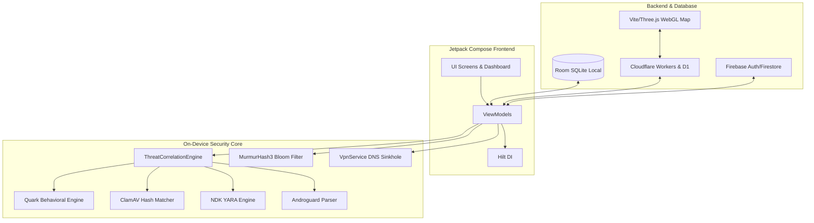
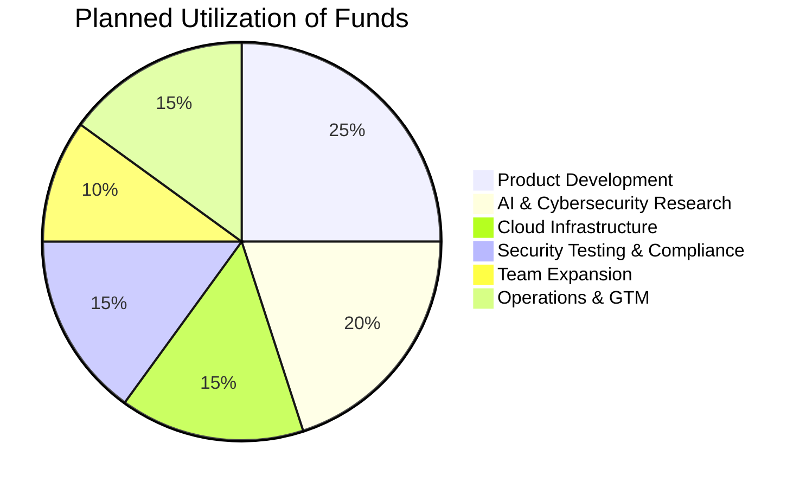

# 🛡️ PROTCTUS
### **On-Device, Offline-First Android Cyber-Security Platform**
> **Incubation Summary & Technical Brief**

---

## 👁️ Vision
To make robust, privacy-first cyber-security accessible to every Android user in India. By embedding intelligent threat detection directly on the device, Protctus operates without dependence on constant cloud connectivity, invasive data collection, or subscription paywalls.

---

## ⚠️ Problem Statement & 💡 Our Solution

| The Problem | The Protctus Solution |
| :--- | :--- |
| **Cloud Dependency & Zero-Days:** Existing mobile security tools rely heavily on cloud signature databases, leaving zero-day and offline threats undetected. | **Offline-First Detection:** Performs real-time static, dynamic, and probabilistic matching entirely local to the device. |
| **Battery & Performance Drain:** Many security apps cause continuous battery drain due to heavy background processes and wake-locks. | **Efficient Low-Overhead Design:** Built using a custom 64KB Bloom Filter and targeted analysis pipelines that bypass battery-intensive background loops. |
| **Low User Engagement:** Antivirus apps suffer from low daily engagement due to alert-only interfaces and lack of user education. | **Gamified Microlearning:** An interactive cyber-hygiene module with XP-based progression, offline sync, and interactive quizzes. |
| **Self-Protection Needs (Roadmap):** Mobile applications rarely protect their own runtime against code tampering, rooting, or reverse engineering. | **Atmanirbhar Chakravyuh (RASP - Planned):** An upcoming native JNI/C++ self-protection layer to block debugger attachment and root-tampering. |

---

## 🛠️ Key Features (MVP)

### 1. 🧠 Multi-Engine Consensus Scanner (Evolution of ThreatBrain)
Evolved from a simple static heuristic scanner into an advanced, offline **Multi-Engine Consensus Pipeline** (`ThreatCorrelationEngine`) that aggregates verdicts from multiple specialized modules:
*   **Quark Engine:** Kotlin-native reimplementation of the 5-stage behavioral crime model, evaluating high-risk combinations of permissions and APIs.
*   **ClamAV Core:** Fast Kotlin-native signature matcher checking file hashes and scanning byte-patterns using Boyer-Moore.
*   **YARA Core:** Native NDK integrated pattern-matching engine using localized rule definitions.
*   **Androguard Core:** Deep APK structure inspector extracting dex string pools, examining Android Manifest intents/components, and reviewing signing certificates.

### 2. 🌸 Bloom Filter Malware Scanner
*   A high-speed, local **64KB probabilistic signature matcher** (BitSet size of `524,288` bits) in `SignatureDatabase.kt`.
*   Uses **MurmurHash3** (32-bit) with 3 independent seeds to achieve constant-time ($O(1)$) offline lookups with a false-positive rate under $1\%$ for up to $36,000$ signature definitions.
*   Pulls from `assets/malware_signatures.bin` dynamically for lightning-fast file verification.

### 3. 🔏 Phishing Shield VPN
*   A local DNS sinkhole using Android's `VpnService` framework.
*   Intercepts DNS requests locally to sinkhole known phishing, adware, and malicious domains, completely offline and without routing user traffic to a remote cloud server.

### 4. 🔍 Dark Web Identity Scanner
*   Provides breach-monitoring identity lookups.
*   Generates comprehensive local PDF security audits and reports directly on the device.

### 5. 🎮 Gamified Microlearning
*   An XP-based cyber-hygiene educational module (`LabChaptersScreen`, `MicrolearningScreen`) designed for first-time smartphone users.
*   Features sequential chapter unlocking and offline-first data persistence synchronizing seamlessly with the Cloudflare/D1 backend.

---

## 🚀 Upcoming Features (Product Roadmap)

### 🕸️ Atmanirbhar Chakravyuh (Native RASP Layer)
A planned native C++/JNI Runtime Application Self-Protection (RASP) layer designed to guard the application against reverse engineering and local tampering.
*   **Environment Guard (`EnvGuard`):** Detects compromised states, including root filesystems (e.g., Magisk, su binaries), active debuggers, and emulator runtimes (Genymotion, Google SDK).
*   **Signature Guard (`SignatureGuard`):** Validates the package certificate's SHA-256 fingerprint against the authorized release key at runtime to block modified/cloned APKs.

---

## 🧱 Technology Stack

*   **Mobile Frontend:** Kotlin, Jetpack Compose, MVVM Architecture, Hilt DI.
*   **Local Storage & Caching:** Room Database (SQLite), EncryptedSharedPreferences.
*   **Edge Backend & Sync:** Cloudflare Workers, Cloudflare D1 Database.
*   **Auth & Central DB:** Firebase Auth, Firestore, Firebase Storage.
*   **Admin Dashboard:** Vite.js, Three.js (WebGL interactive visual threat map).
*   **Native & RASP Layer (Roadmap):** Planned C++/JNI integration for anti-tamper runtime self-protection.

---

## 📈 Project Status & Competitive Edge

### **Current Stage**
*   **MVP Fully Operational:** The core multi-engine scanner pipeline (Quark, ClamAV, YARA, Androguard), Bloom Filter database, Phishing VPN, and gamified microlearning are fully functional.
*   **Tested on Physical Devices:** Working APK packages compiled and tested on real-world Android hardware.
*   **Beta Phase Transition:** Transitioning from early Alpha to structured Beta testing with an expanded external group.

### **Competitive Advantage / USP**
1.  **Unified Security & Education:** Combines advanced offline multi-layered threat detection, network phishing prevention, and gamified cyber-hygiene education in a single package.
2.  **Uncompromising Privacy:** On-device execution minimizes cloud communication, safeguarding user privacy and UPI/banking security.
3.  **Ultra-low Resource Footprint:** Employs optimized data structures (like Bloom filters) to minimize wake-locks and battery drain.

---

## 👥 Founding Team
*   **Jatin Sharma** (Founder)
*   **Swapnil Chaurasiya** (Co-Founder)
*   **Vinayak Chourasiya** (Co-Founder)
*   **Kunal Dhakad** (Co-Founder)

> **About the Team:** Diploma in Computer Science & Engineering students at **Government Polytechnic College, Shivpuri**, with hands-on experience building Protctus end-to-end — spanning native Kotlin development to serverless edge architectures.

---

## 💰 Funding & Utilization

### **Funding Requirement: ₹ 10,00,000**
Sought to scale Protctus from an MVP to a secure, compliant, and production-ready Beta.

*   **Product Development & Engineering (25%):** Enhancing engine detection capabilities and UI smoothness.
*   **AI & Cybersecurity Research (20%):** Improving local heuristics and threat fingerprinting.
*   **Cloud Infrastructure (15%):** Cloudflare Workers/D1 scaling and update distribution.
*   **Security Testing & Compliance (15%):** Vulnerability assessments, source auditing, and Google Play Store compliance.
*   **Team Expansion (10%):** Onboarding core talent for security analysis.
*   **Operations & Go-to-Market (15%):** Local community outreach and educational partnerships.

---

## 🗺️ Market, Impact & Contact

### **Target Market**
*   **Primary:** Individual Android users in India seeking robust, privacy-respecting security (focused on users utilizing UPI payments and government portal services).
*   **Secondary:** Academic institutions and community-driven cybersecurity education campaigns.

### **Expected Impact**
Provides a highly accessible, resource-efficient cyber-security layer to millions of Android users in low-connectivity areas. By coupling active threat mitigation with gamified learning, Protctus raises the baseline cybersecurity awareness of the Indian mobile ecosystem.

### **Contact Details**
*   **Founder:** Jatin Sharma
*   **Email:** founders@protctus.com
*   **Phone:** +91 9074274321
*   **LinkedIn/Website:** linkedin.com/company/protctus
