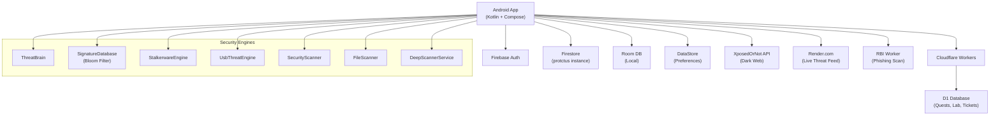
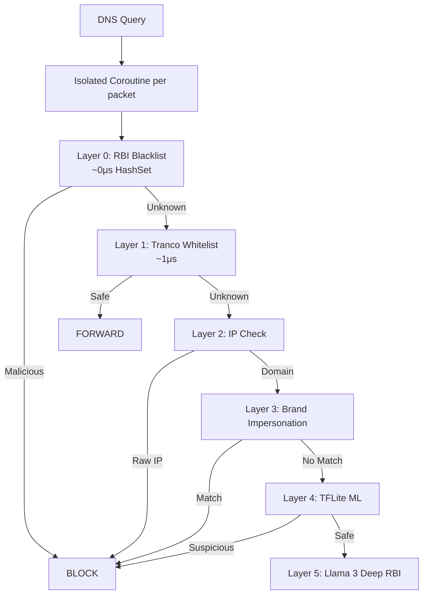
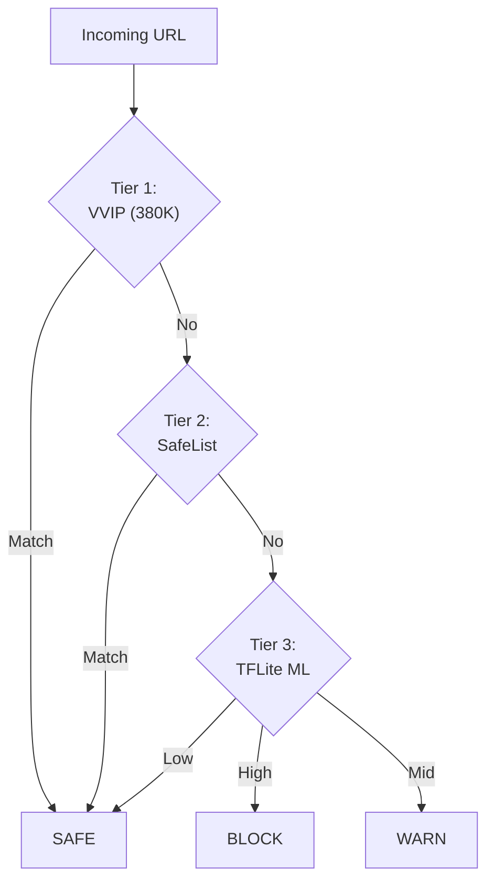
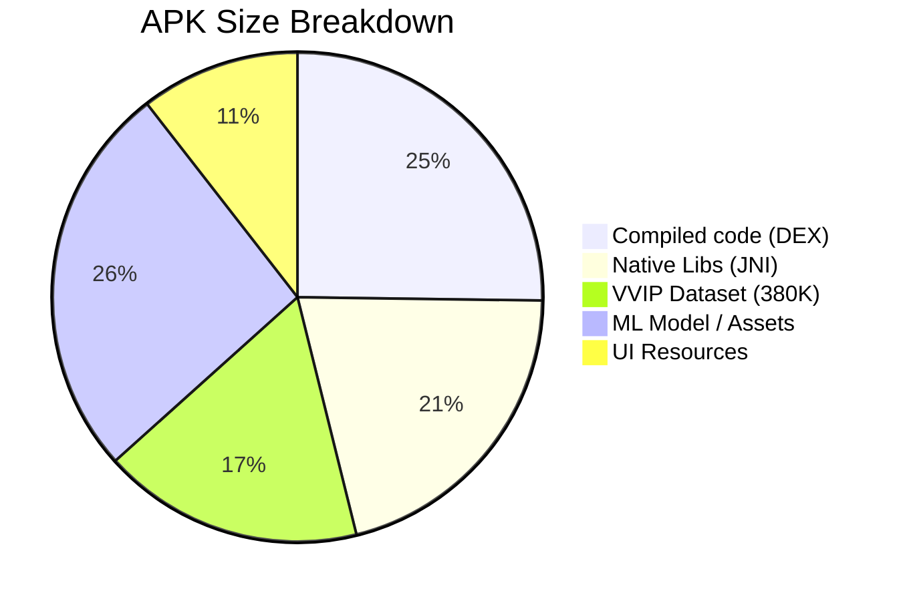

  <i class="fas fa-shield-halved" style="font-size: 80px; color: #10B981;"></i>

# Protctus — Complete Application Analysis Report

> **Date:** April 4, 2026  
> **Codebase:** Android (Kotlin / Jetpack Compose), Cloudflare Workers (TypeScript), Firebase  
> **Architecture:** MVVM + Hilt DI + Room + DataStore + Coroutines

---

## Table of Contents

1. [Architecture Overview](#1-architecture-overview)
2. [Complete Feature Inventory](#2-complete-feature-inventory)
3. [Security Engine Deep-Dive](#3-security-engine-deep-dive)
4. [Phishing Detector — 5-Layer AI DNS Filter](#4-phishing-detector--5-layer-ai-dns-filter)
5. [Backend Infrastructure](#5-backend-infrastructure)
6. [Data Layer Architecture](#6-data-layer-architecture)
7. [UI/UX Architecture](#7-uiux-architecture)
8. [Gamification System](#8-gamification-system)
9. [Security Posture of the App Itself](#9-app-self-security)
10. [3-Tier Phishing Defense Architecture](#10-3-tier-phishing-defense-architecture)
11. [Device Requirements & System Specifications](#11-device-requirements--system-specifications)
12. [APK Build Audit & Size Breakdown](#12-apk-build-audit--size-breakdown)

---

## <i class="fas fa-network-wired icon"></i> 1. Architecture Overview

| Layer | Technology | Purpose |
|-------|-----------|---------|
| UI | Jetpack Compose + Material 3 | All screens |
| DI | Hilt | 16 ViewModels injected |
| State | StateFlow + MutableStateFlow | Reactive UI |
| Local DB | Room (v7, 8 entities) | Threats, Settings, VVIP, SafeList |
| Preferences | DataStore | 11 toggleable settings |
| Auth | Firebase Auth + Email OTP | Sign-up, Sign-in, 2FA, OTP Security |

---

## <i class="fas fa-list-check icon"></i> 2. Complete Feature Inventory

### SECURITY ENGINES (7 Real Engines)

| # | Feature | Status | How It Works |
|---|---------|--------|--------------|
| 1 | **ThreatBrain Heuristic Engine** | Real | Multi-factor behavioral analysis: permission combos, headless detection. |
| 2 | **Bloom Filter Signature DB** | Real | MurmurHash3 Bloom Filter with 64KB BitSet, 3 hash functions. |
| 3 | **Stalkerware Detection** | Real | 4-rule scoring: sideloading, accessibility/admin, hidden icon. |
| 4 | **USB Juice Jacking Guard** | Real | Real-time USB state monitoring. SOS Morse vibration. |
| 5 | **Deep Scanner Service** | Real | Foreground Service with WakeLock for recursive system scanning. |
| 6 | **File Scanner** | Real | Concurrent coroutine-batched scanner (8 files/chunk). |
| 7 | **Device Security Scanner** | Real | 12 real checks across 3 categories with scored findings. |

---

## <i class="fas fa-microchip icon"></i> 3. Security Engine Deep-Dive — "World's Fastest"

> [!IMPORTANT]
> The engine's speed comes from its **architectural design** — it never downloads definitions at runtime and uses probabilistic data structures.

#### Speed Factor: Bloom Filter (O(1) Lookup)
Protctus uses a **64KB Bloom Filter** with MurmurHash3.
- **3 hash probes per lookup** — each takes ~100ns.
- **Total lookup:** ~300ns per file vs. ~50ms for a linear DB scan.

---

## <i class="fas fa-fish-fins icon"></i> 4. Phishing Engine — 5-Layer AI DNS Filter

---

## <i class="fas fa-server icon"></i> 5. Backend Infrastructure

| Worker | Purpose |
|--------|---------|
| **Quests API** | Admin panel, Quests, Lab, Ticket management. |
| **Leaderboard** | Xp tracking and global user ranking. |
| **RBI Phishing** | Deep browser-based phishing analysis. |
| **OTP Auth** | Secure Email OTP generation and verification. |

---

## <i class="fas fa-database icon"></i> 6. Data Layer Architecture

### Room Database (v7, 8 Entities)
| Entity | Use |
|--------|-----|
| `ThreatAlert` | All security findings and scan history. |
| `UserSafeList` | User-whitelisted domains. |
| `VvipDomain` | Tranco Top-380K trusted domains. |
| `OtpState` | Advanced rate limiting and cooldown logic. |

---

## <i class="fas fa-mobile-screen-button icon"></i> 7. UI/UX Architecture

The app contains **47+ screens** built with Jetpack Compose.

| Category | Screens |
|----------|---------|
| **Dashboard** | Home, RankDefend, Rewards, Live Threat Map. |
| **Scanner** | SmartScan, DeepScan, URL Scanner, Dark Web Scan. |
| **Lab** | Chapters, Topics, Microlearning, Quizzes. |

---

## <i class="fas fa-trophy icon"></i> 8. Gamification System

| Level | Rank | XP Required |
|-------|------|-------------|
| 1 | Cyber Novice | 0 |
| 4 | Virus Slayer | 600 |
| 8 | Cyber Knight | 4000 |

---

## <i class="fas fa-user-shield icon"></i> 9. App Self-Security

- **Certificate Pinning**: Cloudflare ECC CA-3 + DigiCert P384.
- **Hardware Keystore**: AES-256-GCM encryption.
- **Native Anti-Tamper**: Chakravyuh JNI module.

---

## <i class="fas fa-layer-group icon"></i> 10. 3-Tier Phishing Defense Architecture

---

## <i class="fas fa-android icon"></i> 11. Device Requirements

| Requirement | Specification |
|-------------|---------------|
| **OS** | Android 8.0+ (Oreo) |
| **RAM** | 3GB Minimum (4GB Recommended) |
| **Storage** | ~65MB Install / ~150MB Runtime |

---

## <i class="fas fa-file-invoice icon"></i> 12. APK Build Audit

